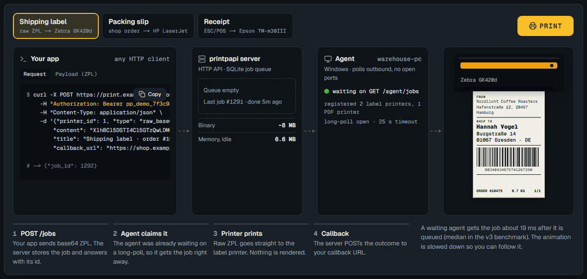
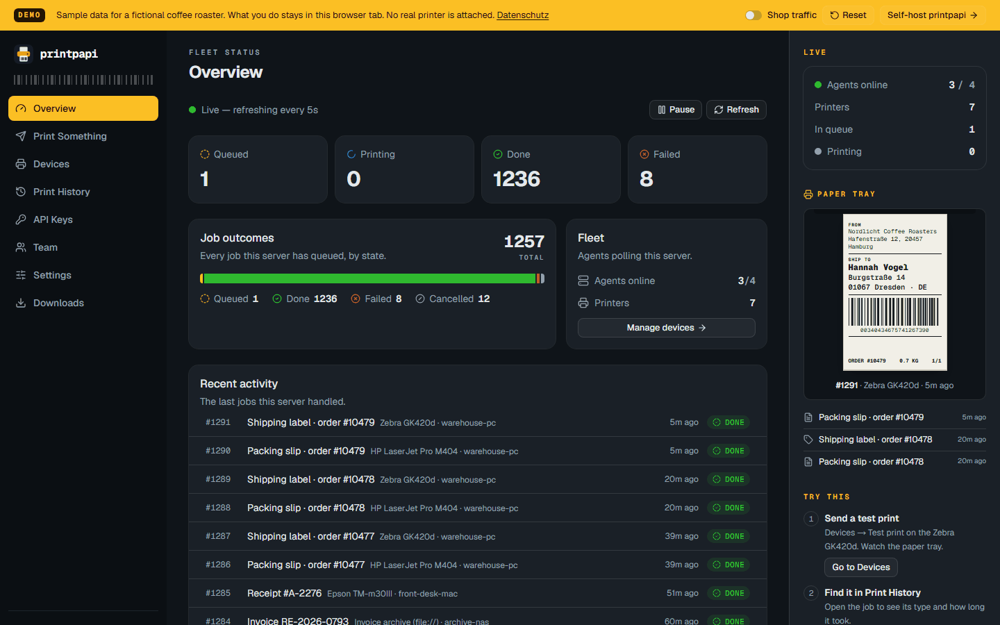

<p align="center"></p>

<p align="center">
  <a href="https://github.com/LukiPrince/printpapi/actions/workflows/ci.yml"></a>
  <a href="https://github.com/LukiPrince/printpapi/releases/latest"></a>
  <a href="https://github.com/LukiPrince/printpapi/pkgs/container/printpapi"></a>
  <a href="LICENSE"></a>
  <a href="https://printpapi.lukaswotzka.com"></a>
  <br>
  <a href="crates/"></a>
  <a href="docs/agent.md"></a>
  <a href="docs/printnode-compat.md"></a>
</p>

# printpapi

**Self-hosted, source-available alternative to [PrintNode](https://www.printnode.com/).** Submit a
print job to a small HTTP API from anywhere; an agent on the machine with the printer picks it
up and prints it: documents **and** label printers (Zebra/ZPL, Bixolon, thermal).

<p align="center">
  <a href="https://printpapi.lukaswotzka.com"></a>
  <br>
  <b><a href="https://printpapi.lukaswotzka.com">Try the live demo</a></b>: send a print job and click through the real dashboard, in your browser, nothing to install.
</p>

- Agent **polls outbound**, so printers behind NAT/firewall work with **no inbound ports**
- Server is **one small Rust binary**: no Python, no Node, nothing else to install (the dashboard is embedded)
- React dashboard (live queue, job history, test print, API keys), REST API, SQLite job queue
- Cross-platform agent, also a single Rust binary: Windows (spooler + SumatraPDF), Linux and macOS (CUPS)
- Print options per job (copies, duplex, paper size, tray, color, page ranges, orientation) +
  capability discovery per printer
- **Shop order → packing slip**: WooCommerce plugin, Shopify webhook, built-in PDF renderer
- **Label templates**: set up once where an image or text sits on a label (sizes from the
  catalogue, drag and scale in the dashboard); every job that names the template is rendered to
  PDF or ZPL by the server ([docs](docs/labels.md))
- **Virtual print server**: a `file://` printer archives the job to a directory instead of paper
  ([docs](docs/agent.md#file-output-virtual-print-server))
- Multi-tenant: orgs isolate API keys, agents, printers and jobs, each with its own
  **e-mail/password logins** for the dashboard ([docs](docs/api.md#accounts-and-login))
- Run it as a service: optional **self-signup** (with a default quota and terms/DPA consent,
  [docs](docs/api.md#self-signup)), password reset by e-mail, a per-org
  **monthly job quota** ([docs](docs/api.md#quotas)), a **retention period** for job data
  ([docs](docs/server.md#retention)), and **plans + a signed billing webhook** that
  works with any payment provider ([docs](docs/billing.md))
- Fleet monitoring: `GET /computers` + online/offline webhooks, Prometheus `/metrics`
- Retry-safe submits (`idempotency_key`) and job deadlines (`expire_after`)
- **PrintNode-compatible API layer**: point an existing SDK/integration at your server
  ([docs](docs/printnode-compat.md))
- **Star CloudPRNT**: Star receipt/label printers poll the server themselves, so there is no agent
  and nothing installed at the site ([docs](docs/cloudprnt.md); built to the published spec, not yet verified
  on a physical printer)
- Source available ([Elastic License 2.0](#license): self-host freely, don't resell it as a service)

## Get started

Want to look first? The [live demo](https://printpapi.lukaswotzka.com) runs the real dashboard in your browser against sample data.

[](https://printpapi.lukaswotzka.com/overview/)

**Running v2 (the Python server)?** v3 uses the same API, environment and database; see the
[migration guide](docs/migration.md) for the upgrade, the three stricter defaults and the way back.

**Server**: download the `printpapi-server-<platform>` archive from the
[latest release](https://github.com/LukiPrince/printpapi/releases/latest) (Windows, Linux and macOS;
unpack it, the binary is `printpapi`):

```bash
PRINTAPI_TOKEN=change-me ./printpapi
```

Or build it from source (needs [Rust](https://rustup.rs/); on Windows the GNU or MSVC toolchain):

```bash
git clone https://github.com/LukiPrince/printpapi && cd printpapi
cargo build --release -p printpapi-server
PRINTAPI_TOKEN=change-me ./target/release/printpapi
```

Open the dashboard at http://localhost:3460 and paste the token. Or use the prebuilt
Docker image, no build needed (amd64 + arm64):

```bash
docker run -e PRINTAPI_TOKEN=change-me -p 3460:3460 ghcr.io/lukiprince/printpapi
```

Or `docker compose up -d`, which keeps the DB in a volume (see [`docker-compose.yml`](docker-compose.yml)).
Prefer to build it yourself? `docker build -t printpapi .`

**Agent**, on the machine with the printers. The easiest way is the setup app: download the
`printpapi-setup-<platform>` file for your system from the
[latest release](https://github.com/LukiPrince/printpapi/releases/latest) (`.exe` on Windows, `.dmg`
on macOS, `.deb` or `.AppImage` on Linux; an AppImage needs `chmod +x` first), open it and follow
the four steps ([docs](docs/agent.md#setup-app)). It also installs a tray icon with a settings window
([docs](docs/agent.md#tray-icon-and-settings)). Every setup download is Beta until someone has run
it by hand. It is not code-signed yet, so the system warns first, and Smart App Control / WDAC block
it: use the Python agent there ([docs](docs/agent.md#locked-down-windows)). Or by hand:

1. Download the `printpapi-agent-<platform>` archive from the
   [latest release](https://github.com/LukiPrince/printpapi/releases/latest) and unpack it (Windows
   x86-64, Linux x86-64/arm64, macOS Apple silicon/Intel). On Windows put `SumatraPDF.exe` next to
   the exe for PDF; Linux and macOS use CUPS (on macOS read the
   [raw-printing note](docs/agent.md#macos)).
2. Issue the agent a key on the dashboard's **Keys** page (or `POST /apikeys`), then create
   `agent.ini` **next to the executable** (the archive has an `agent.ini.example`):

   ```ini
   [agent]
   server_url = http://yourserver:3460
   api_key    = key-from-the-Keys-page
   name       = office-pc
   printers   = Zebra GK420d; HP LaserJet|pdf
   ```

3. Run `./printpapi-agent` (`printpapi-agent.exe` on Windows). For unattended use it should start
   with the machine, see [Run as a service](docs/agent.md#run-as-a-service).

First print: dashboard → **Devices** → **Test print**.

Locked-down Windows (Smart App Control / WDAC / AppLocker) blocks the agent exe because it is not
code-signed yet. There the Python agent is the fallback, see
[docs/agent.md](docs/agent.md#locked-down-windows).

## Performance

v3 (Rust) against v2.5.1 (the last Python server), measured with
[`tools/bench/bench.py`](tools/bench/) on Linux (Docker, 16 cores), fresh database each:

| | v2.5.1 (Python) | v3 (Rust) |
|---|---|---|
| Memory, idle | 29.3 MB | 6.6 MB |
| Memory, 200 agents long-polling | 48.8 MB | 10.5 MB |
| Threads, 200 agents long-polling | 203 | 23 |
| CPU, 200 agents long-polling | 3.3 % of a core | 0.8 % |
| Job reaches a waiting agent (p50 / max) | 598 ms / 1021 ms | 19 ms / 52 ms |
| Job submits, 16 clients | 151 /s | 167 /s |
| Agent cycles (claim, payload, result) | 101 jobs/s | 114 jobs/s |
| Docker image | 200 MB | 55 MB |
| Agent memory (idle, on Windows) | 26.2 MB | 8.5 MB |

A waiting agent is woken the moment its job is queued (Python polled the database once a second
per waiting agent). Submit and cycle throughput are bound by the disk: every job state is
committed durably (`synchronous=FULL`, like v2.5.1), so both servers wait for the same fsyncs. The
server binary is ~8 MB with the dashboard embedded; the agent is ~2.6 MB.

## Why not QZ Tray or PrintNode?

**[QZ Tray](https://qz.io/)** prints from the *browser*: JavaScript in your page talks to a Java
app on the same desktop over a localhost WebSocket. Different architecture, different trade-offs:

|  | QZ Tray | printpapi |
|---|---|---|
| Trigger | browser JS on the operator's machine | any HTTP client: backend, n8n/Zapier, cron |
| Silent printing | needs a **code-signing certificate** per deployment (self-signed → a prompt on every print) | nothing to sign; the agent prints what the server queues |
| Transport | `wss://localhost` from the page ([Chrome's Local Network Access](https://developer.chrome.com/blog/local-network-access) tightens this) | agent **polls outbound**, no listener, no localhost anything |
| Headless / service | [open since 2016](https://github.com/qzind/tray/issues/116) | systemd / launchd / Task Scheduler ([docs](docs/agent.md#run-as-a-service)) |
| Queue when the PC is off | none ([cloud queue open since 2021](https://github.com/qzind/tray/issues/825)) | jobs wait in SQLite, print on reconnect (or expire) |
| Direct USB/HID, scales | yes | no, printers only |

QZ Tray is the better fit if the print *must* start from the user's browser session with no server
in the loop. If printing is something your **backend or automation** does, printpapi's model is
simpler: no certificates, no browser, one HTTP call.

**[PrintNode](https://www.printnode.com/)** is the closest match feature-wise, and printpapi is a
self-hosted alternative to it: same poll-from-behind-NAT model, same job/printer/computer API
shape, without the per-printer monthly fee or sending your documents through someone else's cloud.
It has things we don't (scales, a hosted SLA; see the [roadmap](docs/roadmap.md)). Software you
already wrote against their API can be pointed here: send HTTP Basic auth instead of a bearer token
and the server answers in their JSON shapes
([PrintNode-compatible API](docs/printnode-compat.md)).

*PrintNode is a trademark of PrintNode Ltd. printpapi is not affiliated with, endorsed by, or
sponsored by PrintNode.*

## Documentation

| | |
|---|---|
| [Server](docs/server.md) | how it works, configuration, building, Docker, dashboard (+ rebuilding it), API keys, security |
| [Agent](docs/agent.md) | install, `agent.ini`, printer syntax, labels vs PDF, per-printer setup, service install |
| [HTTP API](docs/api.md) | endpoints, auth, content types, job lifecycle |
| [PrintNode-compatible API](docs/printnode-compat.md) | point an existing PrintNode client at printpapi |
| [Star CloudPRNT](docs/cloudprnt.md) | Star printers polling the server directly, without an agent |
| [Label templates](docs/labels.md) | size and position of images and text on a label, rendered by the server to PDF or ZPL |
| [Recipes](docs/recipes.md) | print from n8n, Zapier, Make, curl in one HTTP node |
| [E-commerce](docs/ecommerce.md) | WooCommerce plugin, Shopify webhook, `POST /orders` |
| [Billing](docs/billing.md) | plans, checkout links, the signed provider webhook, org deletion |
| [Operator API](docs/operator.md) | for a hosted deployment: a service token, the audit log and the overview a separate console reads |
| [Migration](docs/migration.md) | upgrading from v2 (Python) to v3 (Rust): server, agents, changed defaults, rollback |
| [Roadmap](docs/roadmap.md) | what shipped and what is next |

Contributions welcome, see [CONTRIBUTING.md](CONTRIBUTING.md).

## License

[Elastic License 2.0](LICENSE): **source available**, not OSI open source. In plain terms:

- ✅ Run it for yourself, your company, or your clients' printing, free of charge, commercial use
  included. Read it, modify it, redistribute it.
- ✅ An IT service provider, integrator or agency may operate it **for an identified client** and
  charge for installation, hosting, administration and support (an explicit additional permission
  on top of ELv2, see the top of [LICENSE](LICENSE)).
- ❌ Offering it to the public as your own hosted or managed print service. That is the part the
  author intends to offer.

Two scope notes:

- **Everything up to and including v1.4.0 was released under the MIT License and stays MIT**
  ([docs/licenses/MIT-until-v1.4.0.txt](docs/licenses/MIT-until-v1.4.0.txt)). The current license
  applies to later versions.
- The [WooCommerce plugin](integrations/woocommerce) is **GPL-2.0-or-later**, because WordPress
  plugins must be GPL-compatible. It only calls the HTTP API.

Not sure whether your use is covered? [Open an issue](https://github.com/LukiPrince/printpapi/issues)
and ask; the answer is almost always yes.
